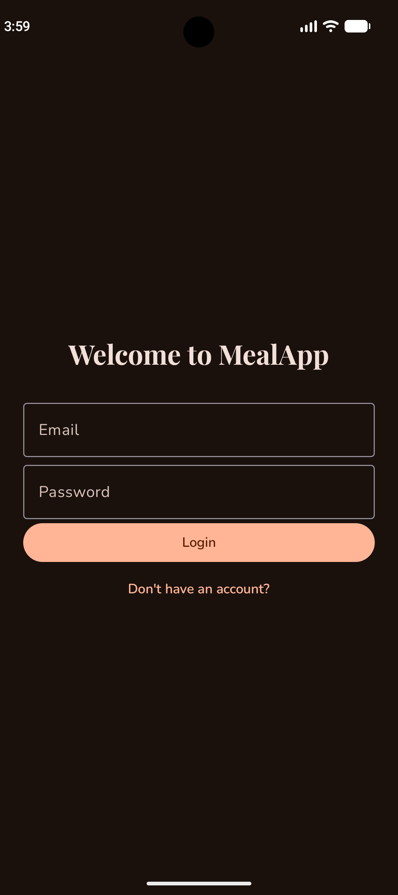
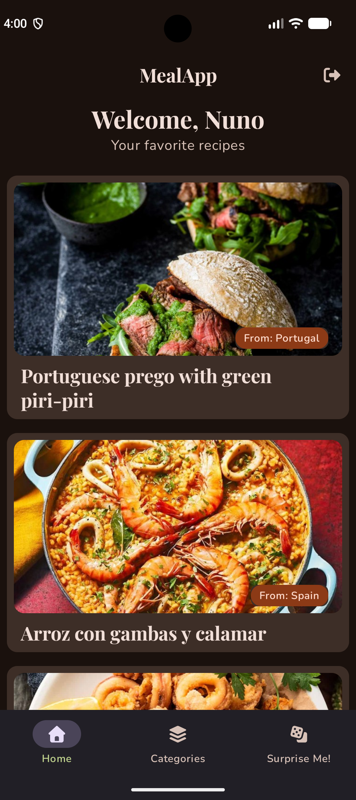
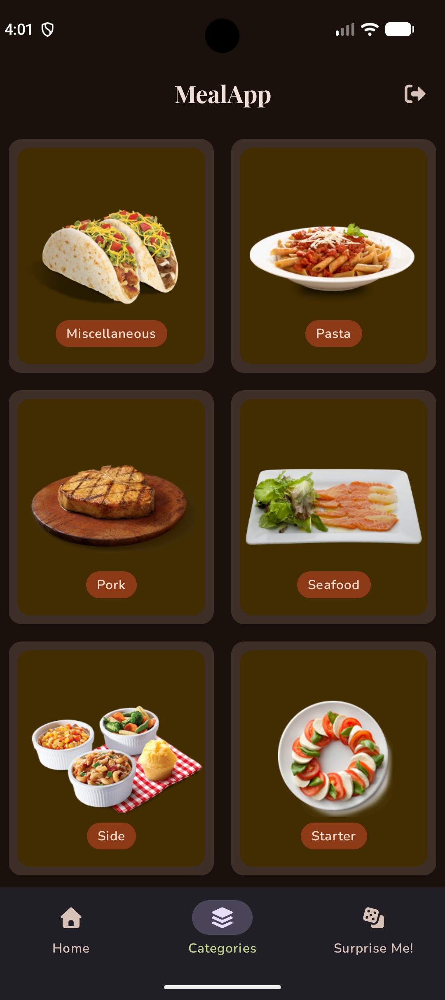
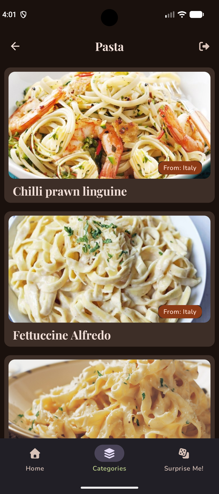
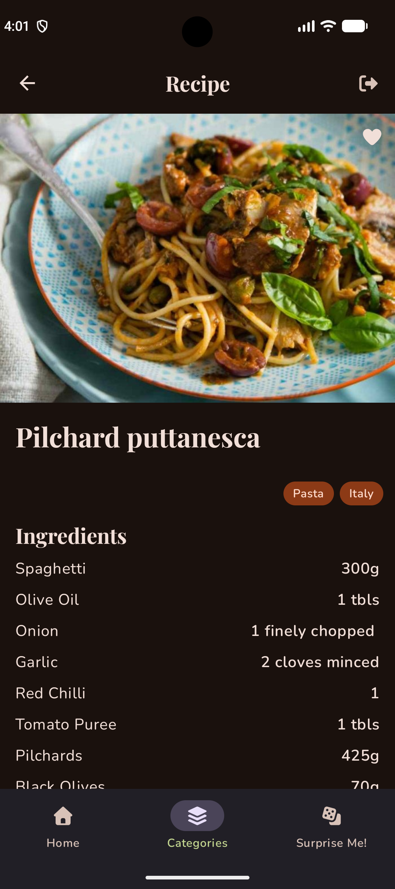
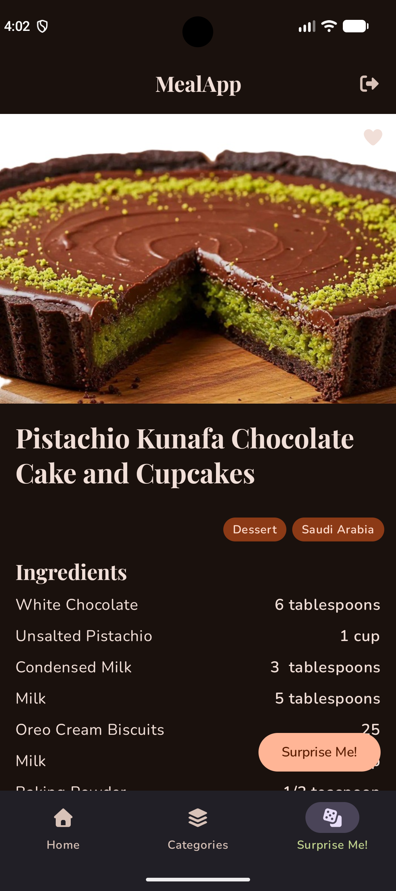

# MealApp 🍽️

An Android recipe app built with **Kotlin** and **Jetpack Compose**, following the **MVVM** architecture. Recipes come from [TheMealDB](https://www.themealdb.com) API, and users can create an account, log in and save their favorite recipes with **Firebase**.

> Developed as a course project to practise MVVM, consuming a REST API, navigation and Firebase integration in Android.

---

## ✨ Features

- **Register, login and logout** with email and password (Firebase Authentication)
- **Stays logged in**: if a session exists, the app opens directly on the Home screen
- **Home**: personalised welcome message and the user's list of favorite recipes
- **Categories**: grid of all meal categories; tapping one shows its meals
- **Meal list**: meals of a category, sorted alphabetically
- **Recipe detail**: image, category, country, ingredients with measures and instructions
- **Surprise me!** 🎲: a random recipe, with a button to get another one
- **Favorites** ❤️: save or remove any recipe from the detail or Surprise screens (Cloud Firestore)
- Loading, error and empty states on every screen
- Custom theme with **light and dark mode** and custom fonts (Playfair Display + Nunito)

---

## 🏛️ Architecture

The app follows **MVVM (Model – View – ViewModel)**, with a repository layer between the ViewModels and the data sources.

```
 View (Compose)          ViewModel              Repository              Data source
┌────────────────┐    ┌────────────────┐    ┌──────────────────┐    ┌─────────────────┐
│ Screen         │───▶│ StateFlow of   │───▶│ MealRepository   │───▶│ MealApi (OkHttp)│──▶ TheMealDB
│ (manager)      │    │ the UI state   │    │ CategoriesRepo.  │    └─────────────────┘
│   └ Content    │◀───│                │◀───│ AuthRepository   │───▶ Firebase Auth
│     (painter)  │    │                │    │ FavoritesRepo.   │───▶ Cloud Firestore
└────────────────┘    └────────────────┘    └──────────────────┘
```

- **Model** – data classes, the API client and the repositories. No layer here knows about the UI.
- **ViewModel** – holds the screen state in a private `MutableStateFlow`, exposed as a read-only `StateFlow`. It survives configuration changes such as screen rotation.
- **View** – each screen is split into two composables:
  - a **Screen** ("manager") that gets the ViewModel, collects the state and triggers requests;
  - a **Content** ("painter") that only receives a state and callbacks, which makes it easy to preview every state (loading, error, empty, success) with `@Preview`.

Asynchronous work (HTTP requests and Firebase calls) is handled with **callbacks** (`onSuccess` / `onError`), passed from the ViewModel down to the data sources.

---

## 📂 Project structure

```
upca.example.mealapp
├── data
│   ├── model          → Meal, MealDetail (+ Ingredient), Category, User
│   ├── remote         → MealApi (HTTP requests with OkHttp + JSON parsing)
│   └── repository     → MealRepository, CategoriesRepository,
│                        AuthRepository, FavoritesRepository
├── utils              → JsonUtils (safe JSON reading)
├── ui
│   ├── components     → MyTopBar, MyBottomBar, Tag
│   ├── navigation     → AppNavigation, Routes
│   ├── screen         → home, categories, meallist, mealdetail,
│   │                    surprise, login, register
│   ├── viewmodel      → one ViewModel + ViewState per screen
│   └── theme          → colors, typography and theme
└── MainActivity.kt    → Scaffold with the top and bottom bars
```

---

## 🛠️ Tech stack

| | |
|---|---|
| Language | Kotlin |
| UI | Jetpack Compose, Material 3 |
| Architecture | MVVM, `ViewModel` + `StateFlow` |
| Networking | OkHttp |
| JSON | `org.json` (`JSONObject` / `JSONArray`) |
| Images | Coil |
| Navigation | Navigation Compose |
| Backend | Firebase Authentication, Cloud Firestore |

---

## 🌐 API

Data comes from the free public [TheMealDB API](https://www.themealdb.com/api.php) (no API key needed for the test key `1`):

| Endpoint | Used for |
|---|---|
| `categories.php` | List of categories |
| `filter.php?c={category}` | Meals of a category |
| `lookup.php?i={id}` | Recipe detail |
| `random.php` | Random recipe (Surprise me!) |

---

## 🔥 Firebase

### Data structure

```
users/
 └── {uid}                 → { id, name, email }
      └── favorites/
           └── {idMeal}    → { id, name, thumb, country }
```

Each favorite document uses the meal id as its name, so the same recipe can never be saved twice.

### Security rules

Each user can only read and write their own data:

```
rules_version = '2';

service cloud.firestore {
  match /databases/{database}/documents {
    match /users/{userId} {
      allow read, write: if request.auth != null && request.auth.uid == userId;
    }
    match /users/{userId}/favorites/{mealId} {
      allow read, write: if request.auth != null && request.auth.uid == userId;
    }
  }
}
```

---

## 🚀 How to run

1. Clone the repository and open it in **Android Studio**.
2. Create a project in the [Firebase console](https://console.firebase.google.com/) and add an Android app with the package name `upca.example.mealapp`.
3. Download the **`google-services.json`** file and place it in the **`app/`** folder.
   > This file is not included in the repository (see `.gitignore`).
4. In the Firebase console:
   - **Authentication → Sign-in method**: enable **Email/Password**;
   - **Firestore Database**: create the database and publish the rules above.
5. Sync Gradle and run the app on an emulator or device (minimum Android 7.0, API 24).

---

## 📸 Screenshots

**LOGIN**

**HOME**

**CATEGORIES**

**MEALS**

**RECIPE**

**SURPRISE ME**

